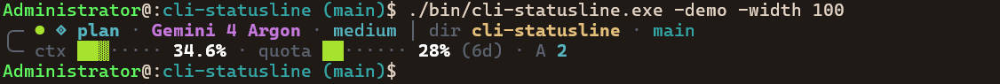
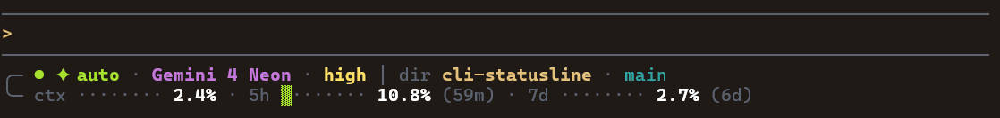

# cli-statusline

A zero-dependency Go status line renderer for [Antigravity CLI (`agy`)](https://antigravity.google/docs/cli/statusline/).





Displays:
- **CLI status**: agent state indicator, `cycle_mode` (`default`, `plan`, `auto`, `accept-edits`), active model name, and effort level
- **Working directory**: current workspace directory name, with Git branch (`<dir> · <branch>`) auto-detected from `.git/HEAD` when `vcs.type == "git"`
- **Context usage**: short Unicode progress bar with usage percentage (traffic-light coloring; switches to bright magenta when `exceeds_200k_tokens` is `true`)
- **Quota usage**: short Unicode progress bar with usage (or remaining) percentage and reset hint
- **Artifacts**: displays `A <count>` when `artifact_count > 0`
- **Layout-adaptive**: automatically switches between wide (single-line), medium (2-line framed), and narrow (compact 2-line) based on `terminal_width`

## Build & Preview

```bash
go build -o bin/cli-statusline ./cmd/cli-statusline
# Preview in your terminal
./bin/cli-statusline -demo
./bin/cli-statusline -demo -width 80
./bin/cli-statusline -demo -width 50
```

On Windows PowerShell:

```powershell
go build -o bin\cli-statusline.exe .\cmd\cli-statusline
.\bin\cli-statusline.exe -demo
```

## Antigravity CLI Setup

Add `statusLine` to `~/.gemini/antigravity-cli/settings.json`:

**Windows:**
```json
{
  "statusLine": {
    "type": "command",
    "command": "F:/GoProject/cli-statusline/bin/cli-statusline.exe"
  }
}
```

**macOS / Linux:**
```json
{
  "statusLine": {
    "type": "command",
    "command": "/path/to/cli-statusline"
  }
}
```

## Flags

| Flag | Default | Description |
| --- | --- | --- |
| `-quota-mode` | `used` | `used` (filled = consumed) or `remaining` (filled = left) |
| `-bar-width` | `8` | Character width of progress bars |
| `-width` | `0` | Override terminal width (`0` uses `terminal_width` from JSON) |
| `-no-color` | `false` | Disable ANSI color output (also respects `NO_COLOR`) |
| `-demo` | `false` | Render a built-in sample payload for quick preview |
